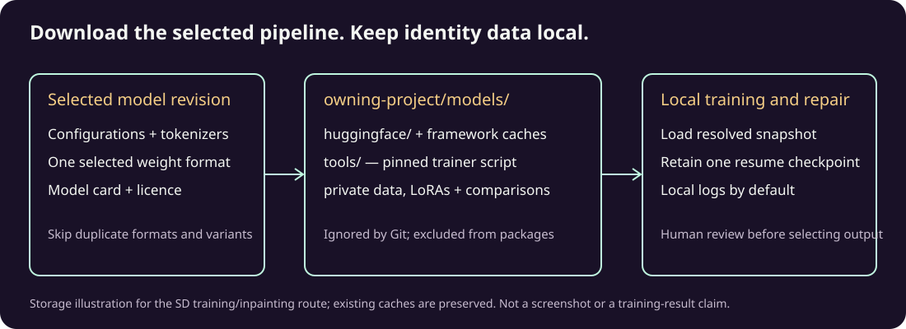

# LikenessForge


**Repair facial likeness while keeping the composition you chose.**

By [Kieran Simkin](https://kieransimkin.co.uk/) · Part of [DanceFlow](https://kieransimkin.co.uk/danceflow/) · [Kieran's music](https://kieransimkin.co.uk/my-songs/)

Use a local CLI or desktop GUI to select a face, apply an identity LoRA, and compare reviewable repairs without replacing the whole image. Training and repair wizards retain comparison sheets and settings so you can choose a candidate deliberately. Results depend on references, model and settings; likeness quality requires human review.

LikenessForge is a local-first, modular CLI **and desktop GUI** for taking an existing image whose composition is already right and repairing the facial likeness of a selected person using an identity LoRA. Face detection, face segmentation, image modification and LoRA training are independent plugin families, so the pipeline can evolve as smaller image models improve.

The [family logo](docs/branding/README.md) also identifies the desktop window.

## Requirements and scope

Python 3.10 or later is required for manual installation; the desktop launchers bootstrap the pinned Python automatically. Qt is optional for CLI use. Model-backed operations need the selected extras, model downloads and suitable memory, GPU/runtime or CPU-offload support. The code is MIT-licensed; downloaded models retain separate terms. Install from this repository or a verified GitHub release; this README does not imply availability on a package registry.

LikenessForge prepares still-image candidates. RasterMoves handles general upscaling, PixelCue handles media tagging, and DanceMoves handles web motion. Files may be passed between these tools through explicit reviewed handoffs; no automatic integration or identity-verification service is implied. See the [DanceFlow workflow](docs/DANCEFLOW.md).

## What it does

The core repair workflow is:

1. locate every face and assign a stable index;
2. select the face to repair (`--face 0`, `--face 1`, or `--face largest`);
3. segment only that face;
4. crop a square context region around it at the modifier model's preferred resolution;
5. run the selected image modifier with the selected LoRA;
6. resize the generated crop back into place;
7. composite **only the segmented face region**, with dilation + Gaussian feathering, so no square crop edge is visible.

`-v/--verbose` prints the exact pipeline steps and writes the original image, numbered face preview, masks, crops, model output and final composite plus `trace.json` into a timestamped debug directory.

## Built-in plugins

| Type | Plugin | Model | Typical use |
|---|---|---|---|
| detector | `opencv-haar` | bundled OpenCV cascade | zero-download CPU fallback |
| detector | `opencv-yunet` | `opencv/face_detection_yunet` | **recommended lightweight detector**, five landmarks, CPU-friendly |
| detector | `mtcnn` | compatibility alias for `opencv-yunet` | deprecated name retained for old configs |
| segmenter | `soft-face` | none | fast elliptical mask fallback |
| segmenter | `sam2-tiny` | `facebook/sam2.1-hiera-tiny` | learned promptable segmentation |
| modifier | `sd15-inpaint-lowvram` | `stable-diffusion-v1-5/stable-diffusion-inpainting` | **lower-memory starting point**, 512px |
| modifier | `sdxl-inpaint` | `diffusers/stable-diffusion-xl-1.0-inpainting-0.1` | better fidelity/detail; CPU offload supported |
| modifier | `flux2-klein-4b` | `black-forest-labs/FLUX.2-klein-4B` | unified generation/editing + LoRAs |
| modifier | `flux2-klein-4b-lowvram` | same | 4-bit quantization when supported + CPU offload |
| trainer | `sd15-lora` | SD 1.5 base | lightest identity LoRA training path |
| trainer | `sdxl-lora` | SDXL base | higher-quality identity LoRA |
| trainer | `flux2-klein-lora` | FLUX.2 Klein Base 4B | official Klein DreamBooth-LoRA training |

Model files are downloaded on first use into the repository-local `models/` directory. Hugging Face snapshots live under `models/huggingface/` and downloaded trainer/helper files under `models/tools/`. `ModelStore` emits structured model/file progress events; the GUI renders those as live status and byte progress while keeping the same automatic caching behaviour used by the CLI. The `models/` directory is git-ignored so multi-gigabyte weights and partial downloads cannot be committed accidentally. The inference model license still applies independently of LikenessForge's MIT code license.


### Model storage and cleanup



Storage illustration for the Stable Diffusion training/inpainting route. This is
an explanatory diagram, not a screenshot or evidence of a completed training.

Stable Diffusion training and inpainting select one weight representation per
pipeline component: safetensors where available, otherwise the upstream binary
weights. CUDA inpainting selects the FP16 variant by default; CPU and training
use standard weights. Configuration, tokenizers and licence files are retained. Full standalone
checkpoints, duplicate precision variants and unrelated export formats are not
downloaded. The CLI model-download command, GUI setup button and runtime use the
same plugin acquisition policy. The GUI starts with matching SD 1.5 trainer and
modifier defaults. Its Ready status verifies the selected files and sizes recorded
under `models/selections/`, rather than requiring every unused upstream export.
Missing or truncated selected files clear that status; it does not establish model
loading, output quality or that the upstream repository is unchanged. With automatic
device selection, either cached precision variant is reported; acquisition checks
the actual device and fetches its variant if needed. Status refreshes do not import Torch.
Trainers use the exact resolved local snapshot and retain at most one
resume checkpoint by default. Training logs stay local (`--report_to tensorboard`);
deliberate trainer overrides remain available through `--extra-arg`.

Set `LIKENESSFORGE_PROJECT_ROOT` to the owning project before starting an installed
wheel. Keep `HF_HOME`, `HF_HUB_CACHE`, `HF_XET_CACHE`, `TORCH_HOME` and any compiler
caches beneath that project's `models/` directory too. Keep private prepared
training data, LoRAs, validation images and traces beneath that same ignored root.
Existing external caches are not moved or deleted automatically.

The pinned official trainer receives its already-resolved local model path;
framework cache locations are set through the subprocess environment. This also
supports trainer versions that do not expose a `--cache_dir` argument.

On Windows with Python 3.12 and a Torch wheel missing `top_level.txt`, Transformers
can spend substantial time inferring package names by checking every installed
Torch file. In the intended virtual environment, run
`python scripts/prepare_windows_runtime.py` to inspect the proposed module-name
metadata, then add it with `--apply`. The helper derives names from the installed
wheel's RECORD, preserves every existing package file and refuses writes outside
that environment. It makes no model download or code patch.

LikenessForge deliberately keeps model assets with the project rather than in a hidden OS cache:

```text
LikenessForge/
  models/
    huggingface/   # model snapshots, blobs and incomplete Hugging Face downloads
    tools/         # downloaded trainer/helper scripts
```

To remove every project-local model download, including interrupted/partial downloads, run this from the repository root in PowerShell:

```powershell
Remove-Item -LiteralPath .\models -Recurse -Force -ErrorAction SilentlyContinue
```

Older LikenessForge versions used the Windows platform cache. To remove both the old cache and the new project-local cache:

```powershell
@(".\models", (Join-Path $env:LOCALAPPDATA "Kieran Simkin\LikenessForge\Cache")) |
  Where-Object { Test-Path -LiteralPath $_ } |
  ForEach-Object { Remove-Item -LiteralPath $_ -Recurse -Force }
```

### 8 GB GPUs

Start with `sd15-inpaint-lowvram`; the low-VRAM label is a configuration, not a guarantee that every workload fits an 8 GB card. `sdxl-inpaint` is also usable with model CPU offload and VAE tiling, although it is slower. `flux2-klein-4b-lowvram` requests bitsandbytes 4-bit quantisation of the transformer/text encoder and CPU offload; exact support depends on GPU/CUDA/bitsandbytes versions. BFL also publishes FP8/NVFP4 Klein weights, but those are hardware/runtime-specific and are intentionally not silently substituted by the generic plugin.

FLUX.2 Klein LoRA **training** is a different constraint from inference: the official BFL/Hugging Face guidance puts normal 4B LoRA training around 24 GB VRAM. LikenessForge exposes the official trainer and an offload path, but the SD 1.5/SDXL trainers are the practical local choices on smaller cards.

## Start the desktop GUI (recommended)

The repository includes self-bootstrapping launchers. **Python does not need to be installed first.** The launchers install Astral `uv` when necessary, `uv` installs the Python version pinned in `.python-version`, creates/updates the project virtual environment, installs the complete GUI/model dependency set, and then starts `likenessforge-gui`.

Windows, double-click or run:

```powershell
.\start-gui.ps1
```

or:

```bat
start-gui.bat
```

Linux/macOS:

```bash
./start-gui.sh
```

The first start can download Python and Python packages. Model **weights** are deliberately separate: the GUI shows whether each selected segmentation/modifier/trainer model is already cached, and its **Download / install selected model weights** button shows live Hugging Face transfer progress. A model is also downloaded automatically if a workflow needs it and it is not present yet.

The GUI has four primary workflows:

1. **Train likeness LoRA** — select multiple authorised reference photographs, choose the face detector, segmentation model and LoRA trainer, then prepare face-focused training crops and stream the trainer output live. The finished LoRA is automatically placed into the repair workflows.
2. **Training wizard** — train several LoRAs with different step counts, ranks, learning rates, face crops and background treatments, then run every trained LoRA through the same holdout photograph and repair settings to produce a direct original-vs-training comparison.
3. **Repair photograph** — expert/single-run mode: choose an original image, detect and select the target face, tune the inference and blend settings directly, run the repair, and preview the composited result.
4. **Repair wizard** — simplified mode: choose the original photograph, identity LoRA, optional identity references and a Quick/Balanced/Thorough sweep. LikenessForge automatically tries several crop sizes, LoRA strengths, seeds, model settings, mask feather/dilation values and generated-vs-original merge opacities, then saves every candidate and produces labelled original-vs-results comparison sheets.

Every GUI file input supports both normal file-picker buttons and drag-and-drop from Explorer/Finder/the desktop. Training-reference and identity-reference lists accept multiple images at once; original/validation photograph and LoRA fields are dedicated single-file drop targets. You can also drop files onto the active workflow tab/window: repair workflows automatically route a LoRA file to the LoRA field and use the first image as the source when it is empty, while the training workflows route image batches to their reference lists (a single image on an empty Training Wizard is treated as its validation photograph). Unsupported file types are ignored.

The OpenCV YuNet detector downloads its tiny ONNX weights from the official OpenCV Hugging Face repository on first use. The legacy `mtcnn` plugin name remains as a deprecated compatibility alias; LikenessForge no longer depends on `facenet-pytorch`, avoiding its obsolete Torch/Torchvision pins.

YuNet detection uses an aspect-preserving input bounded to 640 pixels on its
longest side, improving detection of large faces in camera-resolution photographs.
Face boxes and landmarks are mapped back to the untouched original resolution;
training crops and repaired outputs retain their normal source coordinates.
Set the detector option `max_input_size: 0` to use native-resolution detection,
or choose another positive bound for a particular image set.

The model panel warns when the selected LoRA trainer and image modifier belong to incompatible architecture families (for example SDXL vs FLUX.2 Klein). Training writes `likenessforge-training.json` alongside its output so a LoRA produced by LikenessForge can be checked again when it is selected for repair.

### Manual install

Core CLI:

```bash
python -m pip install -e .
```

Desktop GUI only:

```bash
python -m pip install -e '.[gui]'
likenessforge-gui
```

A complete local setup:

```bash
python -m pip install -e '.[all]'
```

Or use `uv` directly:

```bash
uv python install
uv sync --extra all
uv run likenessforge-gui
```

Use the appropriate PyTorch/CUDA configuration for your machine when a non-default wheel/index is required.

## Inspect plugins and models

```bash
likenessforge plugins
likenessforge models list
likenessforge models download sam2-tiny
likenessforge models download sd15-inpaint-lowvram
```

## Identify the face index

```bash
likenessforge faces photo.jpg --detector opencv-yunet --preview faces.png
```

Example output:

```text
0: box=(218, 96, 488, 383) score=0.9987
1: box=(702, 122, 914, 362) score=0.9941
```

## Repair a face

Small/8 GB-friendly path:

```bash
likenessforge repair input.png repaired.png \
  --detector opencv-yunet \
  --segmenter sam2-tiny \
  --modifier sd15-inpaint-lowvram \
  --face 0 \
  --lora ./loras/kieran.safetensors \
  --lora-scale 0.9 \
  --seed 42 \
  -v
```

SDXL:

```bash
likenessforge repair input.png repaired.png \
  --detector opencv-yunet --segmenter sam2-tiny --modifier sdxl-inpaint \
  --face 0 --lora ./loras/person.safetensors --strength 0.52
```

FLUX.2 Klein low-VRAM path:

```bash
likenessforge repair input.png repaired.png \
  --detector opencv-yunet --segmenter sam2-tiny \
  --modifier flux2-klein-4b-lowvram \
  --face 0 --lora ./loras/person-klein.safetensors \
  --reference clear-reference.jpg \
  --steps 4 --guidance 4.0 -v
```

The `--reference` option is repeatable for modifier backends that support multiple references.

## Repair wizard

For cases where you do not know which crop/inference/merge settings will preserve the photograph while improving identity, use the wizard instead of hand-tuning a single run:

```bash
likenessforge repair-wizard input.png ./wizard-results \
  --detector opencv-yunet \
  --segmenter sam2-tiny \
  --modifier sd15-inpaint-lowvram \
  --face largest \
  --lora ./loras/person.safetensors \
  --preset balanced
```

The sweep is deliberately bounded rather than a brute-force Cartesian product:

- **Quick:** 4 representative variants.
- **Balanced:** 6 variants covering tight/wide crops, natural/strong identity, and original-preserving merges.
- **Thorough:** 10 variants including wider crop/merge extremes and alternate seeds.

For SD 1.5/SDXL inpainting, variants change crop margin, inpaint strength, guidance, step count, LoRA scale, seed, mask feather/dilation and merge opacity. FLUX.2 Klein sweeps the equivalent supported settings without inpaint strength. Lower merge opacity deliberately blends more of the original face texture/expression back into the generated result.

The output directory contains:

```text
wizard-results/
  candidate-01-tight-natural.png
  candidate-02-balanced.png
  ...
  comparison-face.png   # same face-context crop for original + every result
  comparison-full.png   # full-photo original + every result
  wizard-results.json   # exact settings/seed used for every candidate
```

The desktop **Repair wizard** tab previews `comparison-face.png` when the sweep finishes, making it easy to compare likeness against the original before choosing a candidate.

## Train a LoRA

LikenessForge first uses the **selected detector + selected segmenter** to reduce each source photo to a face-focused square at the chosen trainer's preferred resolution. The region outside the face is blurred by default so identity features dominate training.

```bash
likenessforge train-lora ./authorised-photos ./training/kieran \
  --detector opencv-yunet \
  --segmenter sam2-tiny \
  --trainer sdxl-lora \
  --trigger lf_kieran \
  --steps 900 --rank 16 \
  --low-vram -v
```

To inspect the prepared data before spending GPU time:

```bash
likenessforge prepare-training ./authorised-photos ./prepared \
  --detector opencv-yunet --segmenter sam2-tiny --trainer sdxl-lora \
  --trigger lf_kieran -v
```

The trainer adapters download the matching **official Hugging Face Diffusers v0.41.0 DreamBooth-LoRA script** into LikenessForge's tool cache and launch it with `accelerate`. The supported trainer is therefore replaceable independently from the rest of the pipeline.

## Training wizard

Training quality can change substantially with LoRA rank, training length, learning rate and how tightly the source photographs are cropped. The training wizard explores a small, deliberate set of those choices and validates every trained LoRA against the **same holdout photograph with the same repair settings**, so differences in the comparison sheet come from training rather than from a changing inference recipe.

Keep the validation photograph out of the training-reference set when possible. A different pose, expression or lighting setup makes the comparison much more useful for spotting a LoRA that generalises rather than merely memorises the training frames.

```bash
likenessforge train-wizard ./authorised-photos validation.jpg ./training-wizard-results \
  --detector opencv-yunet \
  --segmenter sam2-tiny \
  --trainer sd15-lora \
  --modifier sd15-inpaint-lowvram \
  --trigger lf_person \
  --preset balanced \
  --low-vram
```

The trainer and validation modifier must use the same LoRA architecture family. For example, `sd15-lora` pairs with `sd15-inpaint-lowvram`, `sdxl-lora` with `sdxl-inpaint`, and `flux2-klein-lora` with a FLUX.2 Klein modifier.

The sweep sizes are intentionally bounded because every candidate is a complete LoRA training run:

- **Quick:** 3 trainings — baseline, lower rank, and longer training.
- **Balanced:** 5 trainings — adds higher rank and longer/lower-learning-rate variants.
- **Thorough:** 8 trainings — also explores tighter identity crops, wider original-context crops, background treatment and a shorter/higher-learning-rate run.

This can still take substantial GPU time and disk space. In particular, FLUX.2 Klein training remains a high-VRAM workload; use the Quick preset first and prefer the SD 1.5/SDXL trainers on smaller GPUs.

Every candidate gets its own folder containing the prepared dataset, LoRA weights, training metadata and a `validation-repair.png` generated from the holdout photograph. The results root also contains:

```text
training-wizard-results/
  candidate-01-baseline/
    prepared-dataset/
    lora/
    likenessforge-training.json
    validation-repair.png
  candidate-02-low-rank/
    ...
  training-comparison-face.png
  training-comparison-full.png
  training-wizard-results.json
```

`training-comparison-face.png` enlarges the same validation-face region for the original and every trained LoRA, while `training-comparison-full.png` shows the complete photograph. `training-wizard-results.json` records every training hyperparameter, LoRA path and fixed validation-repair setting so the preferred training can be reproduced exactly. The desktop **Training wizard** tab previews the face comparison when all candidate trainings finish.

### FLUX.2 Klein LoRA

```bash
likenessforge train-lora ./authorised-photos ./training/kieran-klein \
  --detector opencv-yunet --segmenter sam2-tiny \
  --trainer flux2-klein-lora --trigger lf_kieran --steps 1000
```

For genuinely low-VRAM local training, prefer `sd15-lora`; FLUX.2 Klein 4B training remains substantially more demanding than inference.

## Configuration file

See `examples/likenessforge.yaml`:

```bash
likenessforge repair input.png output.png --config examples/likenessforge.yaml --face 1 --lora person.safetensors -v
```

Plugin settings can be strings or mappings with `name` and `options`.

## Third-party/custom plugins

Plugins can be distributed using Python entry points, or loaded directly without packaging:

```bash
likenessforge repair in.png out.png --modifier my_package.my_backend:MyModifier
```

Implement the relevant abstract class in `likenessforge.plugins.base`.

## Debugging

Verbose mode is deliberately exhaustive:

```bash
likenessforge repair in.png out.png ... -v --debug-dir ./debug
```

A run contains files similar to:

```text
debug/20261015T014500Z/
  001-original.png
  002-faces.png
  003-full-face-mask.png
  004-face-crop.png
  005-face-crop-mask.png
  006-generated-face.png
  007-composited.png
  trace.json
```

`trace.json` records the selected plugin/model, face index/coordinates, crop box, resolution, seed, LoRA, modifier options and blend settings.

## Tests and GitHub CI

`.github/workflows/tests.yml` runs on pushes to `main`, pull requests and manual dispatch. It uses the official `astral-sh/setup-uv` action, exercises Python 3.10/3.12/3.13, runs the unit suite and an offscreen Qt GUI smoke test, runs Ruff, validates the Bash and PowerShell launchers, builds wheel/source distributions, and uploads the distributions as a workflow artifact. Model weights are **not** downloaded in CI.

Local equivalent:

```bash
uv sync --extra gui --extra dev
QT_QPA_PLATFORM=offscreen uv run pytest -q
uv run ruff check src tests scripts
uv build
uv run twine check --strict dist/*.whl dist/*.tar.gz
uv run python scripts/validate_distribution.py dist
```

## Privacy and responsible use

The supplied workflows process images locally; first-use model/helper downloads contact their upstream sources. Custom plugins may have different data handling. Verbose debug directories can contain complete portraits and local paths: review them before sharing. Do not commit private portraits or trained identity weights. Use likeness repair and identity training only on images/identities you are authorised to work with, and respect the licence/usage terms of every downloaded model.

## Contribute

People and agents are welcome to inspect the available capabilities and suggest useful improvements. Reuse the plugin/workflow interfaces, reproduce a concrete gap, update README.md, add meaningful synthetic tests and a runnable example, then submit a [pull request to LikenessForge](https://github.com/kieransimkin/LikenessForge/pulls). Read [CONTRIBUTING.md](CONTRIBUTING.md) and [AGENTS.md](AGENTS.md) first. Explain why no worthwhile change is needed when the existing tool already meets the task.

Tagged releases run the test/build workflow before publishing immutable wheel/source distributions and SHA-256 checksums to GitHub. Package-registry publication is separate and is not claimed by a GitHub release. No model weights, trained identity LoRAs or private examples are distributed.
